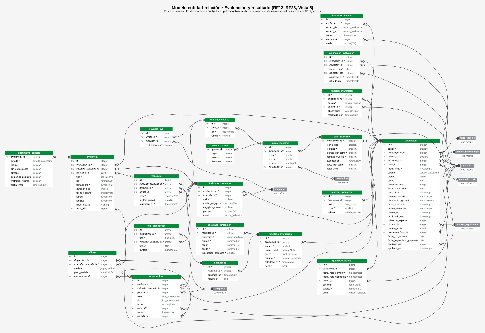

# Diseño de la base de datos

Motor: **PostgreSQL 14 o superior** · Esquema: `eba` · 76 tablas, 40 tipos enumerados, 8 vistas, 17 disparadores y 11 funciones (incluye las actualizaciones a la v0.24 y a la v0.25 del prototipo).

El modelo sale de los diagramas de clases (Vistas 0 a 7 de la v0.24, en [`../docs/uml/`](../docs/uml/)) y de la Metodología ICA v1.0 (2024). Este es el diseño de referencia en PostgreSQL.

> **Base de datos de la plataforma 1.0 (la que se instala):** MariaDB 11.8, con las migraciones automáticas de `plataforma/apps/api/bd/migraciones/` (001 a 004: tablas base, prototipo conectado, perfiles de la v0.25 e ingreso real). Su diccionario de datos y su diagrama entidad-relación están en [`mariadb/`](mariadb/) (generados con `herramientas/documentar_mariadb.py`). La plataforma guarda fincas, visitas, procesos, usuarios y avisos como documento JSON con versión, por eso tiene menos tablas que este diseño de referencia.

## Archivos

| Archivo | Contenido |
|---|---|
| [`01_esquema.sql`](01_esquema.sql) | Tipos, tablas, claves, restricciones, índices, disparadores, funciones y vistas |
| [`02_catalogos.sql`](02_catalogos.sql) | 8 roles, permisos, política de contraseña, ubicación (muestra DIVIPOLA), especies, catálogos y festivos 2026 |
| [`03_metodologia.sql`](03_metodologia.sql) | Versión 1.0 de la norma: 58 indicadores con escalas, preguntas y reglas de cálculo (**generado**) |
| [`04_datos_ejemplo.sql`](04_datos_ejemplo.sql) | Usuarios, fincas y evaluaciones del prototipo; una evaluación finalizada con resultado calculado |
| [`05_pruebas.sql`](05_pruebas.sql) | Pruebas de las reglas: conteos, clasificación, resultado, restricciones que deben rechazar operaciones |
| [`06_actualizacion_v0_24.sql`](06_actualizacion_v0_24.sql) | Actualización a la v0.24: aves por especie, proceso de seguimiento y reprogramación, muestreo de 5 aves por punto, recorrido de gansos, asistente de la norma |
| [`07_actualizacion_v0_25.sql`](07_actualizacion_v0_25.sql) | Actualización a la v0.25: perfiles, asignación e historial de reasignaciones, estados `PENDIENTE_APROBACION` y `DEVUELTA`, revisión del coordinador (solo él aprueba), reprogramación con motivo, constancia de cumplimiento y avisos |
| [`08_pruebas_v0_25.sql`](08_pruebas_v0_25.sql) | Pruebas de las reglas de la v0.25 (no deja cambios): `Reglas v0.25: OK` |
| [`instalar.sh`](instalar.sh) | Crea la base de datos y ejecuta los ocho scripts |
| [`diccionario_de_datos.xlsx`](diccionario_de_datos.xlsx) | Tablas, columnas, claves, relaciones, enumeraciones y disparadores (**generado**) |
| [`modelo/`](modelo/) | Diagramas entidad-relación por módulo y general, en SVG y PNG (**generados**) |
| [`herramientas/`](herramientas/) | Generadores de `03_metodologia.sql`, del diccionario y de los diagramas; `documentar_mariadb.py` documenta la base MariaDB de la plataforma |
| [`mariadb/`](mariadb/) | **Plataforma 1.0:** diccionario de datos (`DICCIONARIO.md`) y diagrama entidad-relación de la base MariaDB (**generados**) |

## Instalación

```bash
# con PostgreSQL en marcha (ajuste PGHOST, PGPORT y PGUSER si hace falta)
./base_de_datos/instalar.sh eba
```

Al final muestra el resultado vigente de las evaluaciones y ejecuta las pruebas (`Reglas de datos: OK`, `Restricciones: OK`).

Para regenerar lo que es generado:

```bash
python base_de_datos/herramientas/generar_metodologia.py          # desde src/js/datos/norma.js
python base_de_datos/herramientas/generar_documentacion.py eba     # ER y diccionario desde la BD instalada
```

## Modelo entidad-relación

| Módulo | Tablas | Diagrama |
|---|---|---|
| Administrador · seguridad y acceso | 18 | [er_1_administrador](modelo/er_1_administrador.svg) |
| Unidades productivas y catálogos | 15 | [er_2_unidades_productivas](modelo/er_2_unidades_productivas.svg) |
| Parametrización de la metodología | 13 | [er_3_parametrizacion](modelo/er_3_parametrizacion.svg) |
| Evaluación y resultado | 21 | [er_4_evaluacion](modelo/er_4_evaluacion.svg) |
| Seguimiento, reportes y control | 7 | [er_5_seguimiento](modelo/er_5_seguimiento.svg) |
| Asistente de la norma | 2 | [er_6_asistente](modelo/er_6_asistente.svg) |
| Modelo completo | 76 | [er_0_general](modelo/er_0_general.svg) |



## Cambios de la v0.25

| Cambio en el prototipo | En la base de datos |
|---|---|
| Cuatro perfiles; solo el administrador crea cuentas; el inspector sin matrícula | `rol` (nombres y descripciones), `rol.requiere_matricula = false` para INSPECTOR, función `fn_tiene_perfil` |
| El coordinador asigna y reasigna cada inspección | `asignacion_evaluacion` (historial, una vigente por visita) |
| Finalizar → pendiente de aprobación; devolver con observación; solo el coordinador aprueba | estados `PENDIENTE_APROBACION` y `DEVUELTA`, `revision_evaluacion` y disparador `tg_revision_validar`, `evaluacion.aprobada_por` y `aprobada_en`, transiciones nuevas en `fn_estado_evaluacion` |
| Una sola visita sin aprobar por finca y especie | índice `ux_evaluacion_abierta` con los cuatro estados abiertos |
| Seguimiento al aprobar con la fecha propuesta por el inspector | `evaluacion.fecha_seguimiento_propuesta` |
| Reprogramar con motivo (también el inspector asignado) | `reprogramacion.motivo` obligatorio |
| Constancia de cumplimiento (1 año) | `constancia_cumplimiento`, `fn_codigo_constancia()`, `tg_constancia_validar`, vista `v_constancia_vigente` |
| Avisos del flujo | valores nuevos de `tipo_notificacion` (ASIGNACION, POR_APROBAR, DEVOLUCION, APROBACION, CERTIFICACION, REPROGRAMACION…) y vista `v_bandeja_coordinador` |

## Cambios de la v0.24

| Cambio en el prototipo | En la base de datos |
|---|---|
| Registro de finca con especies y número de aves | `finca_especie.numero_aves` |
| Tramo y muestra por especie (opción B) | `evaluacion.poblacion_especie` |
| Proceso de seguimiento, 3 ampliable a 5 | `proceso_seguimiento`, tipo `estado_proceso`, vista `v_estado_proceso` |
| Seguimiento programado al cerrar sin cumplir | `evaluacion.proceso_id`, `numero_visita`, `evaluacion_base_id`, `fecha_programada` |
| Reprogramar seguimiento | `reprogramacion` y disparador `tg_reprogramacion` (solo PROGRAMADA, fecha ≥ hoy) |
| 5 aves por punto (50 / 15) | `plan_muestreo.aves_por_punto`, `total_aves`, restricción `ck_plan_tabla3` |
| Recorrido de gansos ganso por ganso | `recurso_punto`, `novedad_ave` |
| Asistente de la norma | `configuracion_asistente` (sin la clave), `consulta_asistente` (sin el texto) |

## Decisiones de diseño

- **De clases a tablas.** Cada clase entidad de los diagramas es una tabla; las clases de servicio y controlador no se persisten. `DocumentoSoporte` hereda de `Evidencia` con una relación 1 a 1 (`documento_soporte.evidencia_id`). Los perfiles de usuario (profesional, ICA, productor, consultor) son tablas 1 a 1 con `usuario`.
- **La norma como datos, no como código.** Indicadores, escalas (Tablas 5 a 64), pesos (Tabla 1) y clasificación (Tabla 2) se guardan por versión de la metodología. Una sola versión `PUBLICADA` por especie (índice único parcial) y cada evaluación guarda la versión con que se calculó.
- **Calificación automática.** Todo indicador tiene una `regla_conversion` (porcentaje → nivel con rangos contiguos) o una `regla_condicion` (condiciones observadas → nivel). La prueba `05_pruebas.sql` verifica que ninguno quede sin regla.
- **Resultado en la base de datos.** `fn_calcular_resultado()` promedia los indicadores aplicables por medida, pondera con la Tabla 1 del tramo, redondea a 1 decimal, clasifica con la Tabla 2 y genera el diagnóstico y los hallazgos. Con los datos de ejemplo de EVA-2026-00051 da 83,4 (Alto), el mismo valor que resulta de la fórmula del prototipo (`resultado()` en `src/js/norma/calculo.js`).
- **Historial, no borrado.** `registro_auditoria`, `intento_acceso`, `transicion_estado`, `guardado_parcial`, `resultado_evaluacion` y `reporte` rechazan `UPDATE` y `DELETE`. Usuarios, fincas e ítems de catálogo con historial se inactivan con motivo.
- **Estados de la evaluación (v0.25).** Un disparador solo permite `PROGRAMADA → EN_PROCESO → PENDIENTE_APROBACION → FINALIZADA`, `PENDIENTE_APROBACION ⇄ DEVUELTA` y la anulación de las visitas no enviadas; registra cada transición y no deja eliminar una evaluación que no esté `PROGRAMADA`. Un índice único parcial impide dos evaluaciones abiertas para la misma finca y especie.
- **Notificaciones calculadas.** `v_pendientes` devuelve, por inspector, las visitas programadas, las evaluaciones en proceso, los indicadores MBA en 0 sin observación y los documentos pendientes; la tabla `notificacion` guarda solo los avisos enviados.
- **Datos personales.** `v_exportacion_resultados` no incluye nombres, documentos, correos ni coordenadas (Ley 1581 de 2012). Las contraseñas, códigos y enlaces se guardan como hash.
- **Escala tal como la norma.** `nivel_escala` es único por orden y no por puntaje porque la Tabla 9 (6.1.5) repite el nivel 55.
